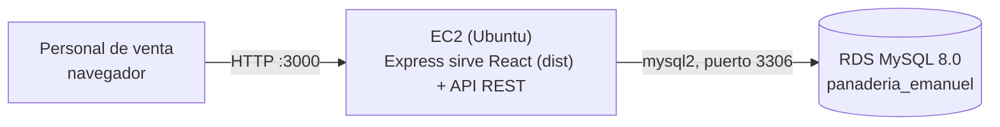
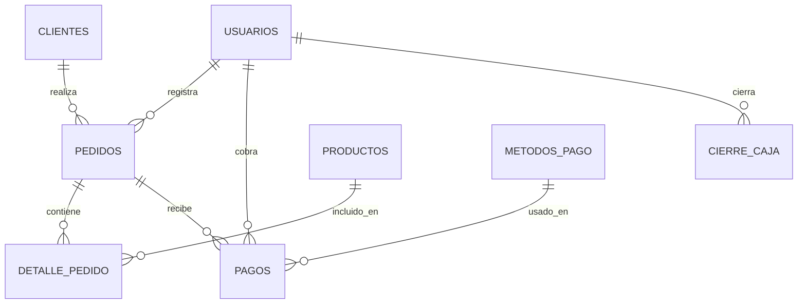

# Documentación Técnica — Sistema de Pedidos y Pagos, Panadería Emanuel

## 1. Contexto y problema
La panadería Emanuel (Tacna) vende todos los días y actualmente registra los
pedidos en un cuaderno físico. Al cerrar el día, el personal solo **tacha**
lo vendido, sin dejar constancia de si el cliente pagó completo, dejó un
adelanto, o únicamente hizo una reserva. Esto genera pérdidas de información
al cuadrar caja y dificulta cobrar lo pendiente.

## 2. Arquitectura de la solución

- **Frontend (React + Vite)**: interfaz con pestañas para Caja, Pedidos,
  Pagos, Clientes y Productos. Se compila (`npm run build`) y su resultado
  estático es servido por el mismo Express.
- **Backend (Node.js + Express)**: expone la API REST bajo `/api/...` que
  recibe pedidos, pagos y entrega reportes de caja.
- **RDS (MySQL)**: persiste toda la información de forma centralizada,
  reemplazando el cuaderno físico.
- Una sola instancia **EC2** atiende tanto la interfaz como la API; la RDS
  solo acepta conexiones desde el *security group* de la EC2, nunca desde
  internet.

## 3. Modelo entidad-relación (8 tablas)

La pieza central es la relación **1 pedido → N pagos**: un mismo pedido
puede tener varios abonos (por ejemplo S/10 hoy, S/20 mañana). La vista SQL
`vista_estado_pedidos` suma esos abonos y determina automáticamente si el
pedido está:
- `reservado_sin_pago` (total pagado = 0)
- `adelanto_parcial` (0 < pagado < total)
- `pagado_completo` (pagado = total)

Esto es exactamente la información que hoy se pierde al tachar en el
cuaderno.

## 4. Configuración de AWS (resumen)

| Recurso | Configuración |
|---|---|
| RDS | MySQL 8.0, `db.t3.micro`, 20 GB, no expuesto públicamente |
| Security Group RDS | Puerto 3306 abierto solo al SG de la EC2 |
| EC2 | Ubuntu 22.04, `t2.micro` |
| Security Group EC2 | Puerto 22 (SSH) desde IP propia; puerto 3000 (API) abierto |
| Runtime | Node.js 18 + PM2 (mantiene la API corriendo y la reinicia si falla) |

Los pasos detallados de creación están en `README.md`.

## 5. Justificación del valor para el contexto local
Tacna es una ciudad con alto movimiento comercial diario (comercio formal e
informal, alta rotación de clientes fronterizos y locales). Para un negocio
como una panadería, que vende y recibe encargos todos los días, la falta de
un registro digital de pagos genera:
- Encargos que se entregan sin haber sido cobrados por completo.
- Discusiones con clientes sobre cuánto habían adelantado.
- Cuadres de caja poco confiables al final del día.

Digitalizar este proceso con un sistema web en la nube (en vez de software
instalado en una sola computadora) permite que el dueño consulte el estado
de caja desde cualquier lugar, evita depender de un cuaderno que se puede
perder o dañar, y sienta una base que luego se puede extender a otros
negocios similares de Tacna (varias panaderías, pastelerías o negocios de
encargos comparten exactamente este mismo problema).

## 6. Evidencias de funcionamiento
Ver la sección 10 de `README.md` para el checklist de capturas necesarias
(RDS disponible, EC2 corriendo, pedido creado, pago parcial vs. pagado
completo, y cuadre de caja del día).
